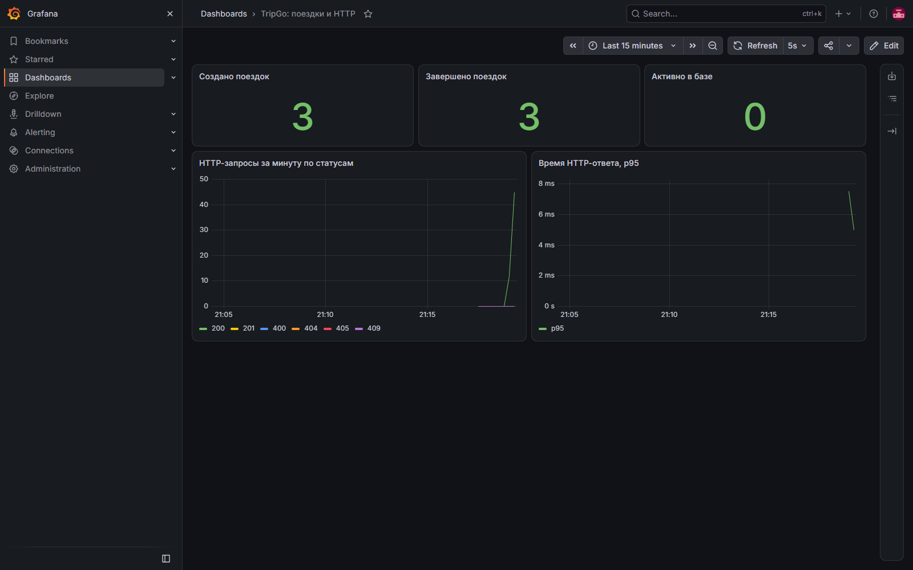
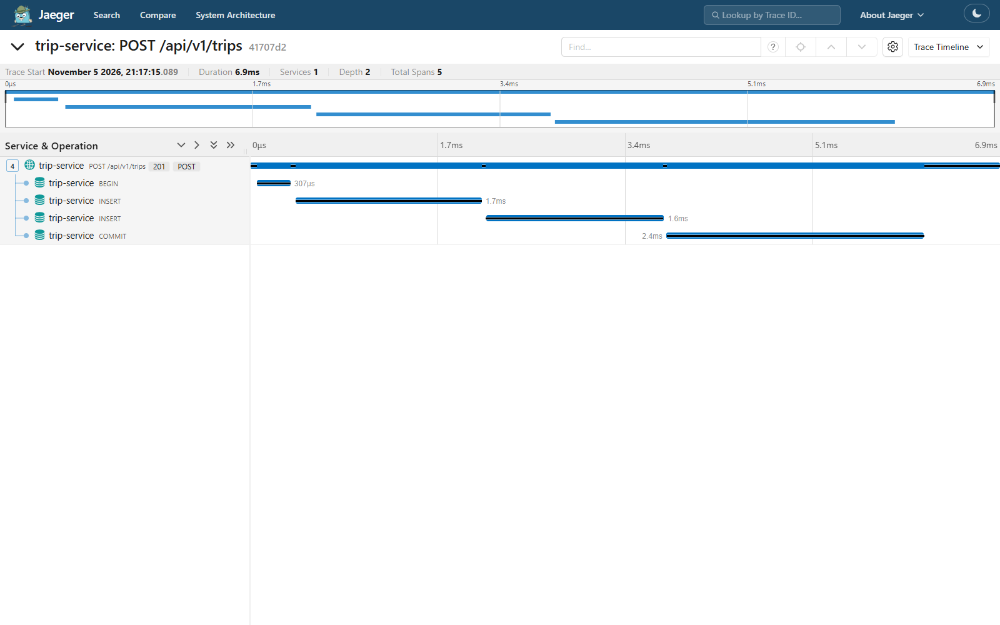

# Trip Service

Сервис создаёт и завершает поездки, принимает координаты и возвращает весь маршрут. Если водитель давно не присылал координаты, сервис запрашивает их через Push Service. Контракт HTTP API находится в `contracts/openapi/trip-service.openapi.yaml`.

## Что нужно для запуска

- Go 1.27.1;
- Ubuntu 24.04 в WSL 2;
- Docker Desktop с интеграцией WSL;
- `tripgoctl`, `make` и C-компилятор для `go test -race`.

## Запуск

Из корня проекта:

```bash
tripgoctl cluster start
tripgoctl environment start
tripgoctl connect
make migrate
make run
```

Профиль из `environment.toml` поднимает PostgreSQL, Push Service и телеметрию. `tripgoctl connect` записывает их адреса в `.env`. Makefile загружает `.env.example` и применяет значения из `.env` поверх него.

Для запросов из второго терминала загрузи настройки и используй адрес из `HTTP_ADDR`:

```bash
set -a
. ./.env.example
. ./.env
set +a
curl -i "http://localhost${HTTP_ADDR}/health"
curl -i "http://localhost${HTTP_ADDR}/ready"
```

`/health` проверяет процесс и не обращается к базе. `/ready` делает `Ping` PostgreSQL с таймаутом.

## API

| Метод | Путь | Действие |
|---|---|---|
| POST | `/api/v1/trips` | Создать поездку |
| GET | `/api/v1/trips/{tripId}` | Получить поездку |
| POST | `/api/v1/trips/{tripId}/finish` | Завершить поездку |
| POST | `/api/v1/trips/{tripId}/positions` | Сохранить точку |
| GET | `/api/v1/trips/{tripId}/positions` | Получить маршрут |

Пример создания:

```bash
curl -i -X POST "http://localhost${HTTP_ADDR}/api/v1/trips" \
  -H 'Content-Type: application/json' \
  -d '{
    "user_id": "5cb72c04-7650-45c9-a79b-bcdba0631e0c",
    "driver_id": "8860b315-ec86-42eb-a17c-7c163d721ff5",
    "start_point": {"latitude": 59.9398, "longitude": 30.3146},
    "end_point": {"latitude": 59.9290, "longitude": 30.3626},
    "price": 1450
  }'
```

Поездка создаётся со статусом `active`. У водителя может быть только одна активная поездка. Повторное завершение возвращает `409 trip_completed`, отсутствующая поездка возвращает `404 trip_not_found`. Ошибки имеют формат `application/problem+json`; клиент может ориентироваться на поле `code`.

Для записи точки укажи ID активной поездки в `TRIP_ID`.

```bash
curl -i -X POST "http://localhost${HTTP_ADDR}/api/v1/trips/$TRIP_ID/positions" \
  -H 'Content-Type: application/json' \
  -d "{\"coordinates\":{\"latitude\":59.935,\"longitude\":30.335},\"recorded_at\":\"$(date -u +%FT%TZ)\"}"
curl -i "http://localhost${HTTP_ADDR}/api/v1/trips/$TRIP_ID/positions"
```

Сохранённая точка возвращается с `201`. Координаты вне диапазона и время более чем на минуту в будущем дают `400 invalid_request`. После завершения поездки маршрут можно прочитать, а запись точки вернёт `409 trip_completed`. Точки отсортированы по `recorded_at`, при равном времени — по `id`.

## Опрос устаревших поездок

```text
Сканер (тикер) → ограниченная очередь → воркеры → Push Service
```

Сканер читает активные поездки порциями. База сравнивает время последней точки с порогом устаревания. Для поездок без точек берётся время начала. Следующая порция продолжается после последней пары `(время, id)`.

Воркер берёт из очереди поездку, по которой дольше всего нет координат. Пока задача ждёт или выполняется, повторный тик её не добавляет. Если очередь заполнена, более старая задача вытесняет самую свежую. Иначе новая задача пропускается. Сканер считает `dropped`, пишет предупреждение и заканчивает текущий обход. Если поездка всё ещё активна и координаты не обновились, она снова попадёт в выборку.

После успешной записи координаты ожидающая задача удаляется из очереди. При остановке сначала завершаются HTTP-запросы, затем останавливается сканер. Воркеры дорабатывают очередь до истечения `SHUTDOWN_TIMEOUT`, после чего закрываются клиент Push Service и пул PostgreSQL.

| Переменная | Значение в `.env.example` | Что задаёт |
|---|---|---|
| `POSITION_CHECK_INTERVAL` | `30s` | Период сканирования |
| `POSITION_STALE_AFTER` | `60s` | Через сколько времени запрашивать координаты |
| `POSITION_WORKERS` | `4` | Число воркеров |
| `POSITION_QUEUE_SIZE` | `100` | Ёмкость очереди |
| `POSITION_SCAN_BATCH_SIZE` | `100` | Размер порции из PostgreSQL |
| `PUSH_HTTP_URL` | `http://localhost:8090` | Адрес Push Service, для окружения берётся из `.env` |
| `PUSH_REQUEST_TIMEOUT` | `1s` | Таймаут отправки команды |

`tripgoctl environment logs push-service` показывает дошедшие команды `REQUEST_POSITION`. Если устройство молчит после отправки, следующий запрос возможен на следующем тике. В Jaeger спан `positions.request` связан со сканированием через span link. HTTP-вызов Push Service виден внутри него.

| Метрика OTel | Что смотреть |
|---|---|
| `tripgo.stale_checks` | Постановки в очередь, дубли и пропуски (`result`) |
| `tripgo.stale_checks.rows_read` | Строки, прочитанные за обход |
| `tripgo.position_requests.queue.size` | Задачи в очереди |
| `tripgo.position_requests.workers.active` | Занятые воркеры |
| `tripgo.position_requests` | Успешные, ошибочные и отменённые задачи (`result`) |
| `tripgo.position_requests.duration` | Длительность HTTP-вызова в секундах |
| `tripgo.positions.saved` | Сохранённые точки |

## Архитектура

```text
cmd/trip-service/main.go
  -> internal/container
       -> HTTP handlers -> usecase -> domain
       -> repository -> postgres
       -> telemetry
```

`main` читает настройки, запускает сервер и обрабатывает остановку. В `container` создаются пул БД, репозиторий, менеджер транзакций, usecase, обработчики и телеметрия.

В `domain/trip` находятся модель поездки, конструктор `New`, проверка полей, переход `Finish` и доменные ошибки. Пакет не зависит от HTTP и PostgreSQL. В `model` лежит входная структура для создания поездки.

Каждый сценарий имеет свой пакет: `usecase/trip/create`, `get`, `finish`. Нужные ему интерфейсы объявлены рядом, в `contract.go`. Репозиторий реализует эти интерфейсы, а в unit-тестах вместо него передаются сгенерированные моки. Такой же подход используется между HTTP-обработчиками и usecase.

HTTP-слой разбирает запрос и собирает ответ. Маппинг доменных ошибок в HTTP-коды находится в одном пакете `http/domainerror`. Текст ошибки PostgreSQL и внутренние детали в ответ `500` не попадают.

### Транзакции и конкуренция

Менеджер транзакций передаёт транзакцию через контекст. Репозиторий выбирает из него исполнителя SQL. Вложенный `Do` использует уже открытую транзакцию. При ошибке и панике выполняется откат, при успехе выполняется commit.

Создание поездки и запись её истории находятся в одной транзакции. Ограничение на активную поездку водителя закреплено частичным уникальным индексом. Проверка перед INSERT сама по себе не защищала бы от двух одновременных запросов.

При завершении usecase проверяет переход через доменную модель. Обновление в БД дополнительно содержит условие `status = 'active'`: из двух одновременных запросов строку меняет только один. История статуса записывается в той же транзакции.

При сохранении координаты сервис обновляет `last_position_at` и добавляет точку в одной транзакции. PostgreSQL сравнивает времена через `GREATEST`, поэтому опоздавшая точка добавляется в маршрут, а время последней координаты остаётся прежним.

### Логи, метрики и трейсы

Middleware идут в порядке `Recover -> Tracing -> Logging -> Metrics -> router`. Паника возвращает безопасный `500`, записывается в лог со стеком и не завершает процесс.

Логи пишутся в stdout в JSON через `slog`. У записей внутри запроса есть `trace_id` и `span_id`. В access log записывается шаблон маршрута, статус и время ответа. Тела запросов и ответов не логируются. Создание и завершение поездки логируются после успешного commit.

Для HTTP используется `otelhttp`, для запросов к базе используется `otelpgx`. Метрики и трейсы отправляются по OTLP. Если коллектор недоступен, API продолжает работать. Активные поездки считаются запросом к базе при сборе gauge, поэтому перезапуск процесса не обнуляет это значение.

| Метрика OTel | Назначение |
|---|---|
| `http.server.request.duration` | Время HTTP-ответа |
| `http.server.active_requests` | Запросы в обработке |
| `db.client.operation.duration` | Время запроса к БД |
| `tripgo.trips.created` | Созданные поездки |
| `tripgo.trips.completed` | Завершённые поездки |
| `tripgo.trips.active` | Активные поездки в БД |

Адреса Jaeger, Grafana и Prometheus выводит `tripgoctl connect`. После HTTP-запроса найди сервис `trip-service` в Jaeger: в трейсе должны быть HTTP-спан и вложенные спаны запросов к базе. `trace_id` из лога позволяет найти тот же трейс. В Grafana выбери Prometheus и метрики `http_server_request_duration*`, `tripgo_trips_created*`.

По умолчанию SDK экспортирует метрики раз в 60 секунд. Для локальной проверки интервал можно уменьшить через `OTEL_METRIC_EXPORT_INTERVAL` (миллисекунды).

Скриншоты проверки:





## Настройки

Полный список переменных и примеры значений находятся в `.env.example`. Для этой работы используются:

| Переменные | Назначение |
|---|---|
| `HTTP_ADDR`, `HTTP_*_TIMEOUT` | Адрес и таймауты HTTP-сервера |
| `DATABASE_URL` | Адрес PostgreSQL из `.env` |
| `DATABASE_MAX_CONNS`, `DATABASE_MIN_CONNS` | Размер пула |
| `DATABASE_MAX_CONN_LIFETIME`, `DATABASE_CONNECT_TIMEOUT`, `DATABASE_QUERY_TIMEOUT` | Время жизни соединения и таймауты БД |
| `LOG_LEVEL` | Уровень логирования |
| `SHUTDOWN_TIMEOUT` | Общий бюджет остановки |
| `OTEL_SERVICE_NAME` | Имя сервиса |
| `OTEL_EXPORTER_OTLP_ENDPOINT` | Адрес коллектора из `.env` |
| `OTEL_EXPORTER_OTLP_PROTOCOL` | `http/protobuf` или `grpc` |
| `OTEL_TRACES_SAMPLER` | Настройка сэмплирования SDK |
| `OTEL_TRACES_SAMPLER_ARG` | Доля для ratio-сэмплера |
| `OTEL_RESOURCE_ATTRIBUTES` | Атрибуты ресурса |

Локальные `.env` и `.tripgo/` не коммитятся.

## Проверки

```bash
make build
make test
make test-integration
make lint
```

`make test` запускает unit-тесты с `-race -count=2` и печатает покрытие домена и usecase. Тесты пула используют управляемый тикер. `goleak` проверяет, что после остановки фоновые горутины завершились.

`make test-integration` применяет миграции и запускает тесты с настоящим PostgreSQL. Они проверяют в том числе отбор устаревших поездок, сортировку маршрута и откат записи координаты. Для отдельной тестовой БД можно задать `TEST_DATABASE_URL`. На неё надо заранее применить миграции.

`make lint` при первом запуске устанавливает закреплённую версию `golangci-lint` в `bin/`. В конфиг включены линтеры курса и правила зависимостей слоёв. Форматирование выполняет `make fmt`.

```bash
make generate        # OpenAPI и моки
make migrate         # применить миграции
make migrate-down    # откатить последнюю миграцию
make migrate-status  # состояние миграций
```

Генераторы закреплены в `go.mod`. Сгенерированные файлы хранятся вместе с исходниками.

## Мутационное тестирование

Ниже результаты второй работы для `internal/domain` и `internal/usecase`.

| Прогон | Всего | Убито | Выжило |
|---|---:|---:|---:|
| До перехода на теги валидации | 39 | 39 | 0 |
| После перехода на теги валидации | 17 | 17 | 0 |

Проверки UUID, цены и координат перенесены в теги `validate`. Gremlins строит меньше мутаций, поскольку числовые сравнения теперь выполняет библиотека. Тесты по-прежнему проверяют границы координат и цены, UUID, переход состояния и ошибки зависимостей. Непокрытых мутаций, таймаутов и ошибок сборки в обоих прогонах нет.

Исходные отчёты: [до](docs/mutation/before.json) и [после](docs/mutation/after.json). Результат относится к заменам, которые поддерживает Gremlins. Использованы стандартные операторы и `INVERT_LOGICAL`, 2 worker, 1 test CPU, коэффициент таймаута 20.

```bash
make mutation
```

Версия инструмента закреплена в Makefile; при первом запуске он устанавливается в `bin/`. Новый отчёт сохраняется в `docs/mutation/latest.json`. Для другого файла:

```bash
make mutation MUTATION_REPORT=docs/mutation/recheck.json
```
