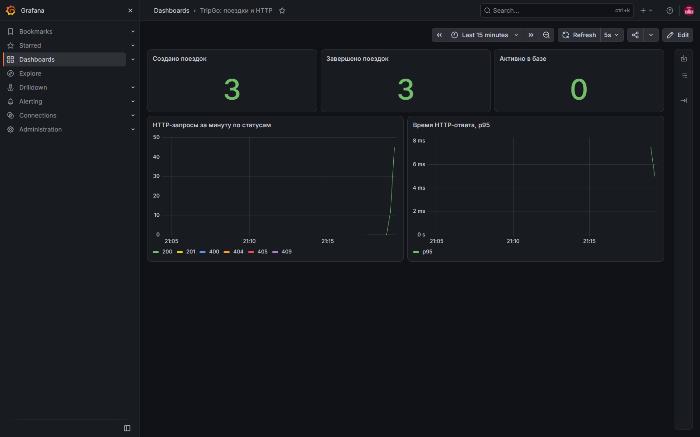
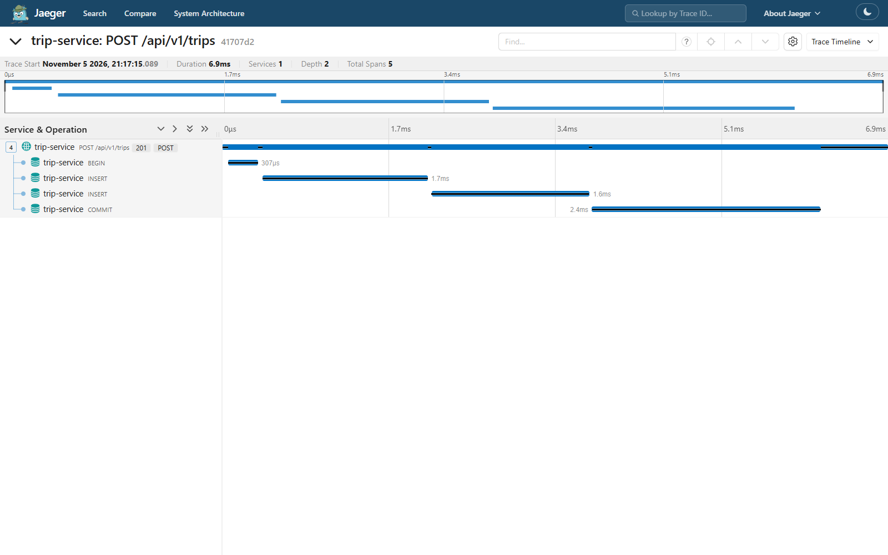

# Trip Service

Сервис создаёт поездки, возвращает их состояние и завершает их. HTTP API описан в `contracts/openapi/trip-service.openapi.yaml`, данные хранятся в PostgreSQL.

## Что нужно для запуска

- Go 1.27.1;
- Ubuntu 24.04 в WSL 2;
- Docker Desktop с интеграцией WSL;
- `tripgoctl`, `make` и C-компилятор для `go test -race`.

Работа ведётся в том же репозитории, что и первая лабораторная. Вторая работа находится в ветке `homework/02`.

## Запуск

Из корня проекта:

```bash
tripgoctl cluster start
tripgoctl environment start
tripgoctl connect
make migrate
make run
```

В `environment.toml` выбран профиль второй работы: PostgreSQL и observability. Адреса базы и коллектора записывает `tripgoctl` в `.env`. Makefile сначала загружает `.env.example`, затем перекрывает его локальным `.env`.

Для запросов из второго терминала загрузи настройки и используй адрес из `HTTP_ADDR`:

```bash
set -a
. ./.env.example
. ./.env
set +a
curl -i "http://localhost${HTTP_ADDR}/health"
curl -i "http://localhost${HTTP_ADDR}/ready"
```

`/health` проверяет процесс и не обращается к базе. `/ready` делает `Ping` PostgreSQL с таймаутом.

## API

| Метод | Путь | Действие |
|---|---|---|
| POST | `/api/v1/trips` | Создать поездку |
| GET | `/api/v1/trips/{tripId}` | Получить поездку |
| POST | `/api/v1/trips/{tripId}/finish` | Завершить поездку |

Пример создания:

```bash
curl -i -X POST "http://localhost${HTTP_ADDR}/api/v1/trips" \
  -H 'Content-Type: application/json' \
  -d '{
    "user_id": "5cb72c04-7650-45c9-a79b-bcdba0631e0c",
    "driver_id": "8860b315-ec86-42eb-a17c-7c163d721ff5",
    "start_point": {"latitude": 59.9398, "longitude": 30.3146},
    "end_point": {"latitude": 59.9290, "longitude": 30.3626},
    "price": 1450
  }'
```

Поездка создаётся со статусом `active`. У водителя может быть только одна активная поездка. Повторное завершение возвращает `409 trip_completed`, отсутствующая поездка возвращает `404 trip_not_found`. Ошибки имеют формат `application/problem+json`; клиент может ориентироваться на поле `code`.

## Архитектура

```text
cmd/trip-service/main.go
  -> internal/container
       -> HTTP handlers -> usecase -> domain
       -> repository -> postgres
       -> telemetry
```

`main` читает настройки, запускает сервер и обрабатывает остановку. В `container` создаются пул БД, репозиторий, менеджер транзакций, usecase, обработчики и телеметрия.

В `domain/trip` находятся модель поездки, конструктор `New`, проверка полей, переход `Finish` и доменные ошибки. Пакет не зависит от HTTP и PostgreSQL. В `model` лежит входная структура для создания поездки.

Каждый сценарий имеет свой пакет: `usecase/trip/create`, `get`, `finish`. Нужные ему интерфейсы объявлены рядом, в `contract.go`. Репозиторий реализует эти интерфейсы, а в unit-тестах вместо него передаются сгенерированные моки. Такой же подход используется между HTTP-обработчиками и usecase.

HTTP-слой разбирает запрос и собирает ответ. Маппинг доменных ошибок в HTTP-коды находится в одном пакете `http/domainerror`. Текст ошибки PostgreSQL и внутренние детали в ответ `500` не попадают.

### Транзакции и конкуренция

Менеджер транзакций передаёт транзакцию через контекст. Репозиторий выбирает из него исполнителя SQL. Вложенный `Do` использует уже открытую транзакцию. При ошибке и панике выполняется откат, при успехе выполняется commit.

Создание поездки и запись её истории находятся в одной транзакции. Ограничение на активную поездку водителя закреплено частичным уникальным индексом. Проверка перед INSERT сама по себе не защищала бы от двух одновременных запросов.

При завершении usecase проверяет переход через доменную модель. Обновление в БД дополнительно содержит условие `status = 'active'`: из двух одновременных запросов строку меняет только один. История статуса записывается в той же транзакции.

### Логи, метрики и трейсы

Middleware идут в порядке `Recover -> Tracing -> Logging -> Metrics -> router`. Паника возвращает безопасный `500`, записывается в лог со стеком и не завершает процесс.

Логи пишутся в stdout в JSON через `slog`. У записей внутри запроса есть `trace_id` и `span_id`. В access log записывается шаблон маршрута, статус и время ответа. Тела запросов и ответов не логируются. Создание и завершение поездки логируются после успешного commit.

Для HTTP используется `otelhttp`, для запросов к базе используется `otelpgx`. Метрики и трейсы отправляются по OTLP. Если коллектор недоступен, API продолжает работать. Активные поездки считаются запросом к базе при сборе gauge, поэтому перезапуск процесса не обнуляет это значение.

| Метрика OTel | Назначение |
|---|---|
| `http.server.request.duration` | Время HTTP-ответа |
| `http.server.active_requests` | Запросы в обработке |
| `db.client.operation.duration` | Время запроса к БД |
| `tripgo.trips.created` | Созданные поездки |
| `tripgo.trips.completed` | Завершённые поездки |
| `tripgo.trips.active` | Активные поездки в БД |

Адреса Jaeger, Grafana и Prometheus выводит `tripgoctl connect`. После HTTP-запроса найди сервис `trip-service` в Jaeger: в трейсе должны быть HTTP-спан и вложенные спаны запросов к базе. `trace_id` из лога позволяет найти тот же трейс. В Grafana выбери Prometheus и метрики `http_server_request_duration*`, `tripgo_trips_created*`.

По умолчанию SDK экспортирует метрики раз в 60 секунд. Для локальной проверки интервал можно уменьшить через `OTEL_METRIC_EXPORT_INTERVAL` (миллисекунды).

Скриншоты проверки:





## Настройки

Полный список переменных и примеры значений находятся в `.env.example`. Для этой работы используются:

| Переменные | Назначение |
|---|---|
| `HTTP_ADDR`, `HTTP_*_TIMEOUT` | Адрес и таймауты HTTP-сервера |
| `DATABASE_URL` | Адрес PostgreSQL из `.env` |
| `DATABASE_MAX_CONNS`, `DATABASE_MIN_CONNS` | Размер пула |
| `DATABASE_MAX_CONN_LIFETIME`, `DATABASE_CONNECT_TIMEOUT`, `DATABASE_QUERY_TIMEOUT` | Время жизни соединения и таймауты БД |
| `LOG_LEVEL` | Уровень логирования |
| `SHUTDOWN_TIMEOUT` | Бюджет остановки сервера и телеметрии |
| `OTEL_SERVICE_NAME` | Имя сервиса |
| `OTEL_EXPORTER_OTLP_ENDPOINT` | Адрес коллектора из `.env` |
| `OTEL_EXPORTER_OTLP_PROTOCOL` | `http/protobuf` или `grpc` |
| `OTEL_TRACES_SAMPLER` | Настройка сэмплирования SDK |
| `OTEL_TRACES_SAMPLER_ARG` | Доля для ratio-сэмплера |
| `OTEL_RESOURCE_ATTRIBUTES` | Атрибуты ресурса |

Локальные `.env` и `.tripgo/` не коммитятся. При `SIGINT` или `SIGTERM` сервер прекращает принимать запросы, дожидается текущих, завершает экспорт телеметрии и закрывает пул БД.

## Проверки

```bash
make build
make test
make test-integration
make lint
```

`make test` запускает unit-тесты с `-race -count=2` и печатает покрытие домена и usecase. Проверяются успешные операции, ошибки зависимостей, валидация, HTTP-коды, метрики и обработка паники.

`make test-integration` применяет миграции и запускает тесты с настоящим PostgreSQL. Есть проверки конкурентного создания и завершения, отката двух записей при ошибке, отката при панике и вложенных транзакций. Тесты используют свои UUID и удаляют только свои данные. Для отдельной тестовой БД можно задать `TEST_DATABASE_URL`; миграции на неё надо применить заранее.

`make lint` при первом запуске устанавливает закреплённую версию `golangci-lint` в `bin/`. В конфиг включены линтеры курса и правила зависимостей слоёв. Форматирование выполняет `make fmt`.

```bash
make generate        # OpenAPI и моки
make migrate         # применить миграции
make migrate-down    # откатить последнюю миграцию
make migrate-status  # состояние миграций
```

Генераторы закреплены в `go.mod`. Сгенерированные файлы хранятся вместе с исходниками. Контракты и миграции первой работы не изменялись. Вторая лабораторная не добавляет API-ручек и бизнес-сценариев.

## Материалы курса

Реализация сверена со слайдами, конспектами и кодом лекций и практик 3–6. Создание поездки выполняет доменный конструктор, интерфейсы объявлены у потребителей, тесты используют GoMock и httptest. HTTP-порт открывается до сообщения о старте, бизнес-счётчики существуют с нулевым значением до первой поездки, metrics provider завершается перед traces provider.

## Мутационное тестирование

Задание со звёздочкой выполнено Gremlins `v0.6.0` для `internal/domain` и `internal/usecase`.

| Прогон | Всего | Убито | Выжило |
|---|---:|---:|---:|
| До правок по материалам курса | 39 | 39 | 0 |
| После правок | 40 | 40 | 0 |

Непокрытых мутаций, таймаутов и ошибок сборки в обоих прогонах нет. Выживших тоже нет, поэтому отдельные тесты для их закрытия не потребовались. Дополнительный мутант появился в проверке ошибки нового `trip.New`; конструктор покрыт тестами успешного создания и отклонения невалидных данных. Существующие тесты проверяют границы координат и цены, UUID, переход состояния и ошибки зависимостей.

Исходные отчёты: [до](docs/mutation/before.json) и [после](docs/mutation/after.json). Результат относится к заменам, которые поддерживает Gremlins. Использованы стандартные операторы и `INVERT_LOGICAL`, 2 worker, 1 test CPU, коэффициент таймаута 20.

```bash
make mutation
```

Версия инструмента закреплена в Makefile; при первом запуске он устанавливается в `bin/`. Новый отчёт сохраняется в `docs/mutation/latest.json`. Для другого файла:

```bash
make mutation MUTATION_REPORT=docs/mutation/recheck.json
```
